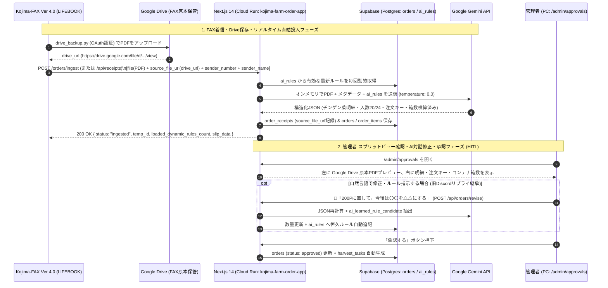

# 小島農園 受発注DXシステム Webアプリ一本化・刷新計画書
（Kojima-Farm-Shipping-Management-App × Kojima-FAX Ver 4.0 & ARCHITECTURE.md Ver 4.1 統合版）

> **【確定方針（2026-10-16 最終決定事項）】**
> 1. **Discordの完全廃止**: Discord連携（Bot、スラッシュコマンド、通知等）はすべて廃止。注文入力・確認・AI対話修正・ルール管理はすべて本Webアプリ内で完結。
> 2. **Supabase（PostgreSQL）メインの単一正本管理**: スプレッドシートやGAS中継を廃し、Supabaseを唯一の正台帳（Single Source of Truth）として一元化。
> 3. **Cloudflare R2・Supabase Storage・Cloud Run側Google Drive中継の完全廃止（ARCHITECTURE.md Ver 4.1 思想継承）**:
>    - FAX原本の保存とGoogle Driveへのバックアップは、農園のLinux FAXサーバー（LIFEBOOK `Kojima-FAX Ver 4.0` の `drive_backup.py`：OAuthユーザー認証）で100%完結している。
>    - `Kojima-FAX`（`order_pipeline_service.py`）はGoogle Drive保存直後に、**PDFバイナリ (`file`)** と **Google Drive閲覧URL (`source_file_url`)**、**発信元メタデータ (`sender_number`, `sender_name`, `text_content`)** をCloud Runへ直接HTTP POSTする。
>    - したがって、Cloud Run（本Webアプリ）側には Cloudflare R2 も、Supabase Storage バケット保存も、Google Drive SDK（サービスアカウント認証・定期ポーリング）も一切不要。PDFバイナリはオンメモリでGemini APIに渡して破棄し、DBには `source_file_url`（Google Drive URL）のみを記録する。
> 4. **Kojima-FAX Ver 4.0 との100%プロトコル互換（404根絶エイリアス設計）**:
>    - `Kojima-FAX` の `normalize_pipeline_url()` が呼び出す `/healthz` および `/orders/ingest` と、指定エンドポイント `/api/receipts`（さらに `/api/receipts/healthz`, `/api/receipts/orders/ingest`, `/api/orders/ingest`）のすべてを受付可能にし、どのURLを設定しても404を起こさない。
>    - `Kojima-FAX` 設定画面の「接続ヘルスチェック」および「🧪 テスト注文送信 (`dry_run=true`)」「🔄 未連携FAXの一括送信」に完全対応する構造化レスポンス（`status`, `temp_id`, `loaded_dynamic_rules_count`, `slip_data`）を返却。
> 5. **旧パイプライン設計書（ARCHITECTURE.md Ver 4.1）の業務ロジック完全継承**:
>    - **注文キー（`order_key`）5段階正規化**: `発注元|納品日|納品先|品目名|規格`（NFKC・波ダッシュU+301C統一・法人格除去・品目統一・空白除去/小文字化・同一伝票内 `#2`, `#3` 付与）。
>    - **明細更新5ルール（§3.3）**: A.新規 / B.再送維持（現場操作列保護） / C.数量変更（`MM/dd HH:mm {旧総P}→{新総P}P` メモ＆アラート） / D.取消復活 / E.和郷園「週間マトリクス」の消滅・取消2段階ガード。
>    - **自然言語によるAI対話修正＆指示書（`ai_rules`）自己更新（§1.3, §5.3）**: 旧Discordリプライ修正をスプリット承認画面（`/admin/approvals`）の対話バー（`POST /api/orders/revise`）へ統合。

---

## 1. システム構成と動作フロー（Target Architecture）

### 全体アーキテクチャ図
```mermaid
flowchart TD
    subgraph S1["1. 農園 Linux FAXサーバー (LIFEBOOK: Kojima-FAX Ver 4.0)"]
        A1["HylaFAX 着信 (recvq)"] --> A2["TIFF→PDF変換 & ローカル保存"]
        A2 --> A3["drive_backup.py (OAuth認証でGoogle Driveへ自動保存)"]
        A3 -->|drive_url 取得直後に即時POST| A4["order_pipeline_service.py (自動再送ワーカー付)"]
    end

    subgraph S2["2. Cloud Run (Next.js 14: kojima-farm-order-app) — ストレージ保存不要・完全ステートレス"]
        A4 -->|POST /orders/ingest または /api/receipts\n(PDFバイナリ + source_file_url + 発信元情報)| B["受信エンドポイント群 (404根絶エイリアス)"]
        A5["管理者 クイック注文入力 (/admin/orders)"] --> B
        B --> D["有効ルール毎回動的取得 (Supabase: ai_rules)"]
        D --> E["Gemini API (温度0.0 + v2.3/Ver4.1プロンプト)\n※PDFはオンメモリ解析のみ"]
        E -->|22列検算・注文キー生成・消滅2段階ガード| F[("Supabase (PostgreSQL)\norder_receipts (Google Drive URL記録)\norders / order_items")]
    end

    subgraph S3["3. 人間承認・AI対話修正・ナレッジ管理 (管理画面)"]
        F <--> G["/admin/approvals 【スプリットビュー承認】\n左: Google Drive 原本プレビュー直接埋め込み\n右: 編集テーブル + 💬AI対話修正・ルール自動学習"]
        F <--> H["/admin/rules 【AIルール管理GUI】\n(取引先別ナレッジON/OFF・モデル自由入力・DryRun検証)"]
    end

    subgraph S4["4. 現場出荷・請求 (タブレット)"]
        G -->|承認完了| I[("harvest_tasks 生成")]
        I <--> J["/field/matrix (週間マトリクス)"]
        I <--> K["/field/shipments (出荷一覧・消し込み)"]
        I --> L["/admin/invoices (月末請求書自動集計)"]
    end
```

### シーケンスフロー


---

## 2. 継承したコア設計仕様（ARCHITECTURE.md Ver 4.1 準拠）

### ① 注文キー（`order_key`）正規化生成ロジック（`lib/pipeline/schemas.ts`）
`発注元|納品日|納品先|品目名|規格` を正規化して `|` で連結する（**伝票Noと数量は絶対に含めない**）。
1. **NFKC正規化**: 全角英数・記号・括弧を半角へ、半角カナを全角へ。
2. **波ダッシュ統一**: `~`・`～`・`∼` はすべて `〜`（U+301C）に統一。
3. **法人格除去**: `農事組合法人`・`株式会社`・`有限会社`・`(株)`・`（株）`・`㈱`・`(有)`・`（有）`・`㈲` を除去。
4. **品目表記ゆれ統一**: `青梗菜`・`チンゲンサイ`・`ちんげんさい`・`ちんげん菜` はすべて `チンゲン菜` に統一。
5. **空白除去・小文字化**: 半角/全角スペースをすべて除去し、英字を小文字にする。
6. **同一伝票内重複**: 同一伝票内で全く同じ注文キーが複数行ある場合のみ、2行目以降に `#2`, `#3` を付与する。

### ② 入数（20 / 24）・固定書式・コンテナ種別集計ルール
- **入数判定**: 株式会社農業総合研究所（NSK）または `24入` は `24`、それ以外（和郷園・房総食料センター・株式会社勘兵衛）は `20`。
- **数量/ケース固定書式**: `総数{総P}点（{ケース}ケース＋端数{端数}点）`
- **コンテナ種別自動分類**:
  - 納品先に `パルシステム` を含む ＝ **青コン**
  - 納品先に `ちばコープ` を含む ＝ **茶コン**
  - 発注元が `農業総合研究所（NSK）` ＝ **農業総研専用折りたたみコンテナ**
  - それ以外 ＝ **通常コンテナ**
- **必要コンテナ箱数**: `箱数 = ケース + (端数P > 0 ? 1 : 0)`（端数の箱は納品先ごとに別々の1箱とし、納品先をまたいで合算しない）。

### ③ 明細行の更新判定5ルール（`lib/ingestion/process-receipt.ts`）
- **A. 新規（同一注文キーなし）**: 新規登録。
- **B. 再送・内容維持（同一キーあり ＆ 総パック数が同じ）**: 伝票No・原本URL・特記事項のみ更新し、**現場スタッフが操作した進捗・メモは絶対に上書きしない**。
- **C. 数量変更（同一キーあり ＆ 総パック数が異なる）**: 数量を更新し、`MM/dd HH:mm {旧総P}→{新総P}P` の数量変更メモとアラートを自動記録。
- **D. 取消からの復活**: 有効状態に戻し履歴を記録。
- **E. 和郷園「週間マトリクス」の消滅・取消2段階ガード**:
  - 二重線・×印・「取消」「0」等の**明示的なキャンセル記載がある場合のみ `取消`** とする。
  - 単なる空欄や行消滅の場合は、自動で取消にせず既存数量を維持したまま `要確認`（`【要確認】最新伝票に記載なし（読飛し・取消の確認）`）とする。
